<!-- Banner -->

  

<h1 align="center">Hello World, my name is Guilherme Israel</h1>

  

  

---

Desenvolvedor **Full Stack** e estudante de **Análise e Desenvolvimento de Sistemas** no **Centro Universitário Senac Nações Unidas**. Atuo no desenvolvimento de aplicações web de ponta a ponta, da modelagem de dados e construção de APIs REST à implementação de interfaces. Meu foco principal é o ecossistema **Java / Spring Boot** no back-end e **React** e **Angular** com **TypeScript** no front-end, complementado por **Python**, **FastAPI** e estudos em **Inteligência Artificial**.

## 💫 Sobre mim

<table>
<tr>
<td width="58%" valign="top">

- **Formação:** Análise e Desenvolvimento de Sistemas, Centro Universitário Senac Nações Unidas
- **Atuação:** sistemas de gestão para agendamento, ponto de venda, controle de estoque e finanças
- **Back-end:** APIs REST com Spring Boot e Spring Security (JWT), Node.js com Express e Prisma, e FastAPI
- **Front-end:** aplicações SPA em React e Angular, com componentização e integração com APIs
- **Dados:** modelagem relacional em MySQL e PostgreSQL, migrações de schema e integração com Power BI para análise
- **Estudos atuais:** arquitetura de software, segurança de aplicações e soluções com LLMs
- **Princípios:** código limpo, manutenibilidade e software orientado a problemas reais

### 📫 Contato

</td>
<td width="42%" align="center">
  
</td>
</tr>
</table>

## 💻 Linguagens e Ferramentas

  

## 🧰 Tech Stack

  
  
  
  
  
  
  
  
  
  
  
  
  
  
  
  
  
  
  
  
  

## 🚀 Projetos em destaque

| Projeto | Descrição | Stack |
|---|---|---|
| 💈 **[Barbearia](https://github.com/Guilherme3578/Projeto-Barbearia-)** | Sistema de agendamento para barbearias: clientes, profissionais, serviços e horários | Java · Spring Boot · MySQL |
| 🛒 **[Estoque & PDV](https://github.com/Guilherme3578/Estoque_PDV)** | Gestão de estoque, ponto de venda e dashboard de relatórios com autenticação JWT | Spring Boot 3.5 · Angular 19 · Tailwind |
| 🌀 **[Vortex](https://github.com/Guilherme3578/Vortex)** | Painel de agendamentos para clínica estética com Kanban em tempo real | Node · Express · Prisma · React · Socket.IO |
| 💰 **[Finanças Pessoais](https://github.com/Guilherme3578/financas_pessoais)** | Receitas, despesas, orçamentos, previsões e integração com Power BI | FastAPI · PostgreSQL · React · Power BI |

## 📊 Estatísticas

  
  

  

  

## 🐍 Contribuições

  

---

<!-- Rodapé -->

  

